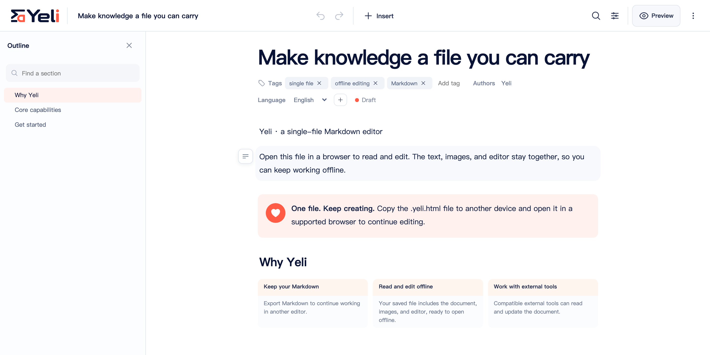

# 页里 / Yeli

**A Markdown editor. For you. And AI.**

English · [简体中文](README.zh-CN.md)

One `.yeli.html` file carries your Markdown source, editor, renderer, and
embedded assets. Open it in a browser to read, edit, and present offline.
Export the Markdown and keep working when your tools change.

[Website — planned](https://yeli.zetury.com/?lang=en) ·
[GitHub](https://github.com/whitesmell/yeli) ·
[Documentation](docs/README.md) ·
[Agent guide](docs/agent-quickstart.md) ·
[Contribute](CONTRIBUTING.md)

**Experimental.** Source: [whitesmell/yeli](https://github.com/whitesmell/yeli).
The website is planned for `yeli.zetury.com` on GitHub Pages.
The website and public downloads are not announced as live. See
[project status](docs/project-status.md) for the remaining release work.



## One file. Keep working.

- **Write on the page.** Edit Markdown in a WYSIWYG block canvas, with headings,
  lists, tasks, tables, links, and embedded images. Find text, organize sections,
  and manage document properties without switching to a source editor.
- **Carry the editor with the document.** Read, edit, and present offline in a
  supported browser, without installing an app, creating an account, or
  starting a server.
- **Keep your source.** Markdown, including YAML frontmatter, remains the
  authored source. Editing preserves untouched source ranges; you can export
  Markdown, script-free read-only HTML, or print/PDF.
- **Let an external Agent continue.** The file format, CLI, and Skill help
  filesystem Agents locate context, make narrow changes, and verify the result.
  Yeli has no built-in chat or model API.

The interface and starter documents support Simplified Chinese and English.
Changing the interface language leaves your document language and text intact.

## Get started

Until reviewed public downloads are available, build an experimental starter
from a trusted source checkout. Use the Node.js version pinned in
[`.nvmrc`](.nvmrc):

```sh
nvm use
npm ci
npm run build:single:all
```

If you use another Node version manager, select the same pinned version.
Dependency installation needs network access; the built document works offline.

1. Open `dist/html/starter.en.yeli.html` or
   `dist/html/starter.zh-CN.yeli.html` in a supported browser.
2. Choose **Edit**, change a paragraph, and give the document a title.
3. Open **More** and save a copy. Depending on browser capabilities, Yeli may
   ask for a destination or download a new `.yeli.html` file.
4. Reopen the saved file and confirm your edits are there. Keep an untouched
   starter for your next document.

Direct overwrite is available only when the browser supports it and you grant
permission. Recovery and history are local to that browser when storage is
available; they do not replace saving a file.

The [first-edit tutorial](site/docs/content/yeli/quickstart.en.md) walks through
the round trip. The [tutorial source guide](site/docs/README.md) explains the
bilingual Yeli and Markdown courses and their offline handbooks.

## Work with an Agent

An external filesystem Agent can pre-read a Yeli document, locate the Markdown,
patch selected lines with a freshness check, and validate that the runtime shell
has not changed. The Markdown source stays available when you change tools.

The helper is packaged as a separately installable CLI:

```sh
npm run pack:cli
```

Follow the [Agent quick start](docs/agent-quickstart.md) to install the local
tarball and configure your Agent. The package includes a generic
[`skills/yeli`](skills/yeli/SKILL.md) Skill. The [full Agent reference](docs/agents.md)
defines operations and validation receipts. No public npm package is announced.

## Develop and contribute

After the dependency setup above, start the development app:

```sh
npm run dev
```

Validate both generated starter files separately:

```sh
npm run validate:single
npm run validate:single -- --locale en
```

A successful build or validation does not certify a public release.
See [development](docs/development.md) for checks, empty and optional advanced
builds, and browser setup; the [release runbook](docs/releasing.md) covers the
remaining evidence and signing requirements. Complete-file sizes and the
deferred historical 100 KB target are documented in
[compression](docs/compression.md).

The default editor includes block-local raw-text fallback. Whole-document
Source/Split belongs to the separately composed advanced profile; see
[architecture](docs/architecture.md).

| Path                            | Purpose                                                              |
| ------------------------------- | -------------------------------------------------------------------- |
| `src/`                          | Browser runtime, editor, rendering, storage, translations, and brand |
| `site/`                         | Homepage, bilingual tutorial sources, and website checks             |
| `scripts/`                      | File helper, build tools, and release validation                     |
| `packages/cli/`, `skills/yeli/` | Standalone CLI and document-use Skill                                |
| `tests/`                        | Unit, integration, security, browser, and synthetic fixtures         |
| `docs/`                         | Development, format, architecture, and release references            |
| `.github/`                      | CI, Pages workflow, issue forms, and pull request template           |

The website builds into ignored `dist/site/`; GitHub Pages is the selected
hosting target, with DNS managed in Cloudflare. See [website development](site/README.md)
for local preview. Internal plans, design studies, and private working records
stay outside the [public source scope](docs/public-scope.md).

Read [CONTRIBUTING.md](CONTRIBUTING.md) before submitting changes. Use the
[repository issues](https://github.com/whitesmell/yeli/issues)
for reproducible bugs and scoped proposals. Report vulnerabilities privately
as described in [SECURITY.md](SECURITY.md).

## Trust and compatibility

Editable `.yeli.html` contains executable code. Open it only from trusted
senders or origins; use static HTML, PDF, or Markdown exports for untrusted
publication. Browser save, storage, and mobile behavior vary; see
[browser support](docs/browser-support.md).

New Yeli releases accept only `.yeli.html`. Old `.aimd.html` files remain
untouched and are not opened or automatically migrated. To move old content,
export standard Markdown with the old helper and import it into a separate
Yeli document.

## License

Yeli uses the [MIT License](LICENSE). Third-party components retain their own
licenses; see [third-party notices](docs/third-party-notices.md). The project
license covers the software and associated documentation, not documents or
assets you create or import with Yeli.
