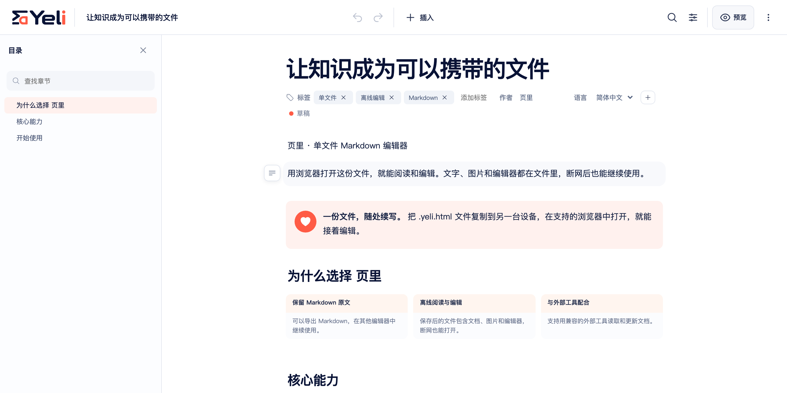

# 页里 / Yeli

**人和 AI，都好用的 Markdown 编辑器。**

[English](README.md) · 简体中文

让 Agent 交付一份你能继续编辑的文档。页里把 Markdown 原文、编辑器、
渲染器和内嵌图片放进一份 `.yeli.html`。
用浏览器打开，离线阅读、编辑与演示。

**[让 Agent 开始](#让-agent-开始)** ·
[体验编辑器](https://yeli.zetury.com/sample.zh-CN.yeli.html) ·
[官网](https://yeli.zetury.com/?lang=zh-CN) ·
[使用文档](https://yeli.zetury.com/docs/zh-CN/index.html) ·
[Agent 指南](docs/agent-quickstart.zh-CN.md) ·
[参与贡献](CONTRIBUTING.zh-CN.md)

## 让 Agent 开始

把这句指令复制到你的 Agent 对话中：

> 阅读 https://yeli.zetury.com/skill.md，按指引开始创建和编辑 Yeli 文档。

接着交给它一个任务：**“把这些会议记录整理成一份新的 `meeting.yeli.html`，
返回校验后的文件。”** 在浏览器打开结果，就能继续写作。

[Yeli Skill](skills/yeli/SKILL.md) 引导 Agent 完成首次准备、创建或修改文档、
校验结果。Agent 需要能联网、运行命令并读写本地文件。
在可信源码副本中，一次 `npm run setup:agent` 就能准备 CLI、Skill 和两种语言的模板，
并返回它们的准确路径。不需要全局安装或修改 Agent 配置。

环境要求与完整命令见 [Agent 快速入门](docs/agent-quickstart.zh-CN.md)，
也可[自行构建工具](#从源码构建)。



## 为什么用页里？

- **直接编辑，所见即所得。** 在区块画布里使用标题、列表、待办、表格、链接与
  内嵌图片，查找文字、整理章节、管理文档属性，无需来回切换源码与预览。
- **文档带着编辑器走。** 在支持的浏览器中离线阅读、编辑与演示，
  不用安装应用、创建账号或启动服务器。
- **原文始终保留。** 包括 YAML frontmatter 在内的 Markdown 是创作源。
  编辑时保留未修改范围的原文，也可导出 Markdown、无脚本只读 HTML，
  或打印 / 保存为 PDF。
- **让外部 Agent 接着做。** 文件格式、CLI 与 Skill 帮助文件系统 Agent
  定位上下文、局部修改，并检查文档中的可执行代码是否保持不变。

应用界面与起始文档均支持简体中文和英文。
切换界面语言不会改写文档语言或正文。

## 开始使用

1. 在浏览器打开**[中文示例](https://yeli.zetury.com/sample.zh-CN.yeli.html)**
   或 **[English example](https://yeli.zetury.com/sample.en.yeli.html)**。
2. 点击**编辑**，修改一段文字，再给文档起一个标题。
3. 选择**更多 → 保存副本**。根据浏览器能力，页里会让你选择保存位置，
   或下载一份新的 `.yeli.html`。
4. 从磁盘打开保存的文件，确认修改已经保留，之后即可离线继续写作。
   另留一份未修改的起始文档，供下次使用。

使用 Yeli 文件不需要安装应用或注册账号。
如需自己构建起始文档，见[从源码构建](#从源码构建)。

只有浏览器支持且你授予权限时，才能直接覆盖原文件。
恢复与历史在存储可用时保存在当前浏览器中，不能替代将文件保存到磁盘。

可编辑 HTML 包含可执行代码，只应打开可信来源提供的 `.yeli.html`。
分享阅读版时，请导出只读 HTML、PDF 或 Markdown。

[第一次编辑与保存](https://yeli.zetury.com/docs/zh-CN/yeli/quickstart.html)
介绍完整操作过程。[文档中心](https://yeli.zetury.com/docs/zh-CN/index.html)
提供 Yeli、Markdown 教程和可编辑离线手册。

## 让 Agent 接着做

页里支持能读写本地文件的外部 Agent。CLI 帮助 Agent 检查文档、
定位 Markdown，并在核对修订号或原文哈希后局部修改。
修改回执包含前后的壳哈希，Agent 可据此核对可执行代码是否保持不变。
页里没有内置聊天或模型 API。

工具准备完成后，可以在源码副本中检查已保存的文件：

```sh
node dist/cli/bin/yeli.js pre-read notes.yeli.html
node dist/cli/bin/yeli.js extract notes.yeli.html
node dist/cli/bin/yeli.js validate notes.yeli.html
```

从其他目录操作时，请使用 `dist/agent/setup.json` 中的 `paths.node` 和
`paths.cli` 绝对路径。[完整 Agent 参考](docs/agents.md)定义操作语义与校验回执。
如需独立安装 CLI，可运行 `npm run pack:cli` 构建本地 tarball，再按
[安装说明](docs/agent-quickstart.zh-CN.md#单独安装-cli可选)配置。
目前未宣布公开 npm 包。

## 从源码构建

使用 [`.nvmrc`](.nvmrc) 固定的 Node.js 版本。以 `nvm` 为例：

```sh
git clone https://github.com/whitesmell/yeli.git
cd yeli
nvm use
npm ci
npm run setup:agent
```

如使用其他 Node 版本管理器，请选择相同版本。
安装依赖需要联网；构建后的文档可以离线使用。

命令准备 CLI 和 Skill，构建并校验两种语言的起始文件，
将各项绝对路径写入 `dist/agent/setup.json`。
用支持的浏览器打开任一起始文件：

- 简体中文：`dist/html/starter.zh-CN.yeli.html`
- English：`dist/html/starter.en.yeli.html`

运行 `npm run dev` 启动开发应用。分别校验两种语言的起始文件：

```sh
npm run validate:single
npm run validate:single -- --locale en
```

官网提供示例与离线手册，尚未宣布编辑器稳定版。
本地构建或校验成功不等于公开发布认证。
剩余发布工作见[项目状态](docs/project-status.zh-CN.md)。

## 文档

| 目标                  | 文档                                                                                                             |
| --------------------- | ---------------------------------------------------------------------------------------------------------------- |
| 学习 Yeli 与 Markdown | [使用教程与离线手册](https://yeli.zetury.com/docs/zh-CN/index.html)                                              |
| 使用外部 Agent        | [CLI 与 Skill 配置](docs/agent-quickstart.zh-CN.md) · [操作参考](docs/agents.md)                                 |
| 了解浏览器行为        | [浏览器支持、保存与恢复](docs/browser-support.md)                                                                |
| 开发或集成 Yeli       | [开发文档](docs/development.zh-CN.md) · [文件格式](docs/format.md) · [架构](docs/architecture.md)                |
| 查看发布要求          | [项目状态](docs/project-status.zh-CN.md) · [发布说明](docs/releasing.md) · [压缩与文件大小](docs/compression.md) |

全部开发参考见[文档索引](docs/README.zh-CN.md)。

<details>
<summary>目录结构与构建说明</summary>

| 路径                            | 用途                                             |
| ------------------------------- | ------------------------------------------------ |
| `src/`                          | 浏览器运行时、编辑器、渲染、存储、翻译与品牌实现 |
| `site/`                         | 首页、双语用户教程源文件与网站检查               |
| `scripts/`                      | 文件型 helper、构建工具与发布校验                |
| `packages/cli/`、`skills/yeli/` | 独立 CLI 与文档操作 Skill                        |
| `tests/`                        | 单元、集成、安全、浏览器测试与合成夹具           |
| `docs/`                         | 开发、格式、架构与发布参考                       |
| `.github/`                      | CI、Pages 工作流、Issue 表单与 PR 模板           |

默认编辑器支持区块内原文编辑作为安全后备；全篇源码 / 分栏编辑属于
单独构建的高级版。[开发文档](docs/development.zh-CN.md)介绍测试、空白版、
高级版构建与浏览器准备；[发布说明](docs/releasing.md)介绍签名与发布证据。
历史 100 KB 目标已暂缓；完整文件大小见[压缩说明](docs/compression.md)。

官网与双语教程通过 GitHub Pages 托管，由 Cloudflare 管理 DNS。
网站构建到被 Git 忽略的 `dist/site/`。
本地预览见[网站开发说明](site/README.md)，课程与手册源文件见
[教程编写说明](site/docs/README.md)。
内部计划、设计研究与私有工作记录不纳入[公开源码范围](docs/public-scope.zh-CN.md)。

保存、存储和移动端行为因浏览器而异，详见[浏览器支持](docs/browser-support.md)。
Yeli 只接受 `.yeli.html`。旧 `.aimd.html` 保持原样，不会自动打开或迁移。
如需转移旧内容，应使用旧版 helper 导出标准 Markdown，
再单独导入新的 Yeli 文档。

</details>

## 参与贡献

欢迎报告问题、提出范围明确的功能建议、改进文档和翻译。
请先阅读[贡献指南](CONTRIBUTING.zh-CN.md)，了解开发方式与项目边界，
再通过 [Issue](https://github.com/whitesmell/yeli/issues) 或 Pull Request
提交可复现示例或明确的修改说明。

安全问题请按[安全策略](SECURITY.zh-CN.md)私下报告。

## 许可证

Yeli 采用 [MIT 许可证](LICENSE)。第三方组件保留各自的许可证，
详见[第三方声明](docs/third-party-notices.md)。
本许可证适用于项目软件及配套文档，不适用于你使用 Yeli 创作或导入的文档与资源。
