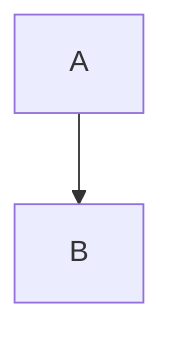

# Heading with [reference][guide]

Paragraph with an [inline link](./guide.md "Guide") and .

中文输入、日本語、مرحبا،emoji 🧭👩‍💻, entity &amp;, escaped \*literal\*, and  two  spaces.

- outer
  - [ ] nested task
  - nested item with `|` code

> Quote with **strong** text.

| Name | Value |
| :--- | ---: |
| alpha | keep |

```ts
const closing = "``` inside a string";
```

[guide]: ./reference.md "Reference"

[^note]: Footnote stays source-safe.

<aside data-keep="yes">Raw HTML stays source-safe.</aside>



$$E = mc^2$$

:::unknown-extension preserve=true
opaque body
:::
